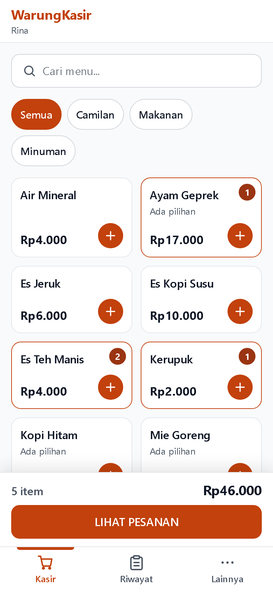
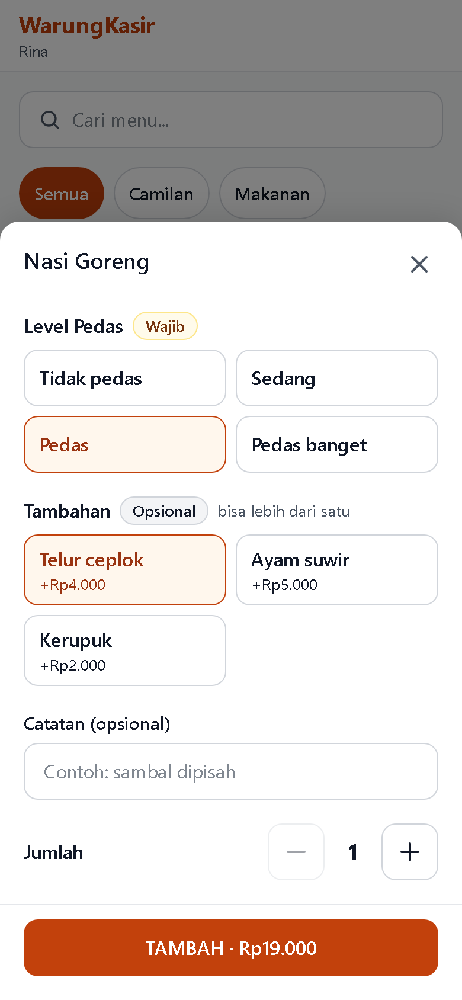
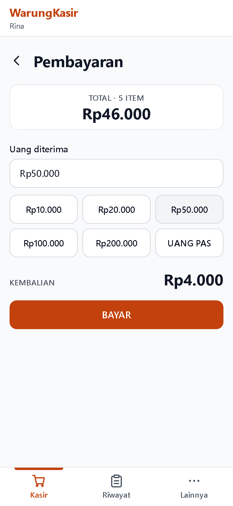
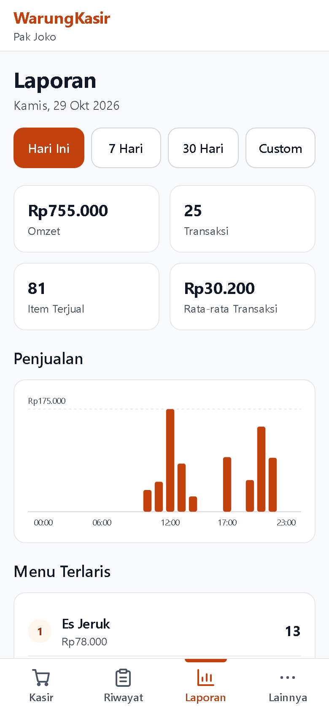
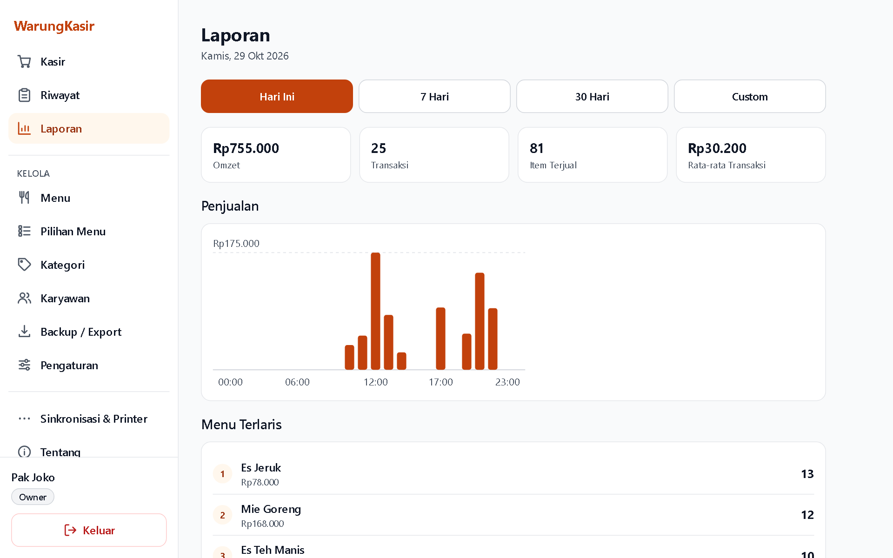
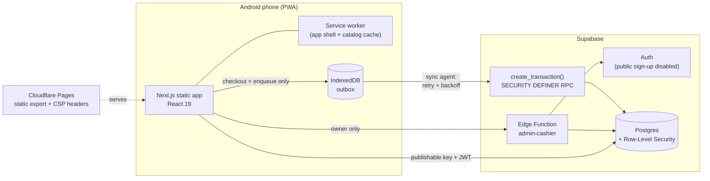

# WarungKasir

**Offline-first point-of-sale PWA for small Indonesian food stalls (*warung*).**
A cashier takes orders on a cheap Android phone, gets paid, and prints a receipt over Bluetooth. This works even with the internet down, and every sale syncs exactly once when the connection returns.

[](https://github.com/vacelni/kasir/actions/workflows/ci.yml)


> **Try it:** [warungkasir-demo.pages.dev](https://warungkasir-demo.pages.dev). Tap *Coba sebagai Kasir* (cashier) or *Coba sebagai Pemilik* (owner). The demo runs on its own Supabase project with a fictional store and 30 days of sales, and it resets every hour ([how](docs/DEMO.md)).
>
> **In production since October 2026.** A real food stall runs on it: the owner manages the menu and reads reports, and cashiers ring up sales on Android phones. It was tested on a real device: install, offline sale, kill the app, reconnect, sync once.

<p align="center">
  
  
  
  
</p>
<p align="center">
  
</p>

---

## Why this exists

Small warungs mostly track sales on paper or in their head. The usual POS apps need a subscription, a tablet, or a stable connection, and a roadside stall often has none of those. WarungKasir was built around four constraints:

- **Zero running cost.** It runs on a static site (Cloudflare Pages) and the Supabase free tier, with no server to pay for.
- **Works on a low-end Android phone.** It is mobile-first (tested at 360/390/412 px) and installable as a PWA.
- **The internet is unreliable.** A sale is never lost and never counted twice.
- **Two roles with different trust levels.** The owner sees everything. Cashiers only sell and see their own history, and the database enforces that, not just the UI.

## Features

| Area | What it does |
|---|---|
| **Cashier** | Menu grid with search and category tabs, cart, product options (e.g. spice level, extra toppings), exact-change and change calculation |
| **Offline sales** | Sales are written to an IndexedDB outbox first, then synced by a background agent with retry, backoff and a visible status for each sale |
| **Receipts** | ESC/POS receipt printing to 58 mm / 80 mm Bluetooth thermal printers via Web Bluetooth |
| **History** | Transaction history and receipt detail; sales still waiting to sync are shown next to synced ones |
| **Reports** | Revenue, transaction count and average sale; sales chart; best-selling products by period (owner only) |
| **Menu admin** | Products, categories, option groups, availability toggles |
| **Employees** | Owner creates, deactivates and resets cashier accounts (privileged Edge Function) |
| **Backup** | CSV export of sales, items and menu |

## Architecture



### Design decisions worth reading

- **Checkout writes locally, always.** Online or offline, checkout does exactly one thing: a `strict`-durability IndexedDB write. The sale survives a crash or power loss the moment the success screen appears. The sync agent reaches the server later. One code path means no separate "offline mode" to get wrong. See [`features/offline/outbox.ts`](features/offline/outbox.ts).
- **Exactly-once sync.** Every sale has a client-generated UUID. Writes to the outbox and the `create_transaction` RPC are both idempotent on it, so a double tap, a retry or a dropped response can never create a duplicate sale.
- **Errors are classified, not just retried.** [`features/offline/sync.ts`](features/offline/sync.ts) maps each failure to one of three outcomes:
  - **transient** (network, timeout, 5xx, expired JWT): retry with backoff;
  - **permanent** (business rule violated, integrity error): keep the sale on the device and let the user retry by hand;
  - **session** (server revoked the session): sign in again. The outbox is never touched.
- **The server validates every sale.** The RPC checks each line's arithmetic and the total, rejects products from another store, and rejects a sale ID that belongs to another cashier. It deliberately accepts the price the device had cached, because an offline sale may legitimately use yesterday's menu. This is a documented, accepted risk (`docs/SECURITY.md` E.12).
- **Authorization lives in Postgres.** RLS policies isolate stores and roles.
- **Cashier accounts go through an Edge Function.** Managing them needs the privileged Auth API. The function checks that the caller is the store's active owner inside its own code, because a valid JWT alone is not enough. If a later step fails, it rolls back the auth user it just created.
- **Static export, no server.** Next.js `output: 'export'` on Cloudflare Pages. The build refuses to run if a secret or `service_role` key is in `NEXT_PUBLIC_*`, and it generates the CSP from the configured Supabase URL.

## Testing

| Layer | Tooling | Count |
|---|---|---|
| Unit + component | Vitest, Testing Library, fake-indexeddb | **1,091 tests** in 76 files |
| Database (schema, grants, RLS, RPC) | pgTAP via `supabase test db` | **365 assertions** in 7 suites |
| Edge Function over real HTTP | Vitest against the local Supabase stack | 21 tests |
| End-to-end | Playwright on 360/390/412 px phones, desktop Chromium, Microsoft Edge, the production `out/` build, and offline/service-worker scenarios | 726 test runs in the full matrix |

CI ([`.github/workflows/ci.yml`](.github/workflows/ci.yml)) runs lint, typecheck, unit tests and build on every push. It also replays every migration plus seed data on a fresh database and runs the pgTAP suite against it.

## Tech stack

**Frontend:** Next.js 16 (App Router, static export), React 19, TypeScript 6, Tailwind CSS 4, `idb`, Web Bluetooth, Service Worker
**Backend:** Supabase (Postgres, Auth, Row-Level Security, PL/pgSQL RPC, Deno Edge Functions)
**Testing:** Vitest, Testing Library, Playwright, pgTAP
**Ops:** GitHub Actions, Cloudflare Pages, generated security headers / CSP

## Running locally

Requirements: Node.js 24, Docker Desktop.

```bash
npm ci
npx supabase start          # local Postgres, Auth, Studio
npx supabase db reset       # apply migrations + seed data
cp .env.example .env.local  # fill in values from `npx supabase status`
npm run dev                 # http://localhost:3000
```

Seed accounts (local only, password `password123`): `owner.a@warungkasir.test` (owner) and `kasir1.a@warungkasir.test` (cashier).

```bash
npm run lint && npm run typecheck && npm run test   # no Supabase needed
npm run test:db                                     # pgTAP (needs local Supabase)
npm run test:e2e                                    # Playwright
```

Full operational guide: [`docs/RUNBOOK.md`](docs/RUNBOOK.md).

## Project documentation

The project was fully specified before it was built. These documents are in Indonesian:

- [`docs/PRD.md`](docs/PRD.md): product requirements, user flows, business rules
- [`docs/TECHNICAL_SPEC.md`](docs/TECHNICAL_SPEC.md): architecture and the reasoning behind each decision
- [`docs/DATABASE.md`](docs/DATABASE.md): schema, RLS, RPC contracts
- [`docs/SECURITY.md`](docs/SECURITY.md): threat model and controls
- [`docs/TEST_PLAN.md`](docs/TEST_PLAN.md): test strategy and coverage map

## License

[MIT](LICENSE) © Vacelnino Faiz Fadeli
