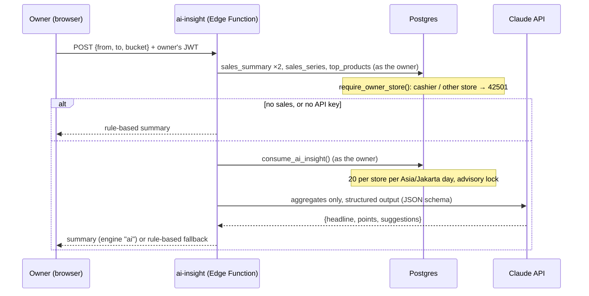

# AI sales summary ("Ringkasan AI")

An optional card on the owner's Laporan page. The owner presses **BUAT RINGKASAN** and gets a short
summary of the period on screen (a headline, two to four findings with numbers, and one to three
practical suggestions) in Bahasa Indonesia.

It is the one AI feature in the project, added on explicit instruction after the MVP (CLAUDE.md
"Do Not Overbuild" lists AI features as out of the MVP). It is **off by default**: the production
store only gets it if both switches below are turned on deliberately.

## Switches

| Switch | Where | Effect when unset |
| --- | --- | --- |
| `NEXT_PUBLIC_AI_INSIGHT=1` | build environment (inlined into the static bundle) | the card is not rendered at all |
| `ANTHROPIC_API_KEY` | Edge Function secret (`supabase secrets set`) | the function still answers, with a rule-based summary (`engine: "rules"`) and no quota use |

## Flow

## Security and privacy

- **No secret Supabase key.** The function calls Postgres with the publishable key plus the caller's
  own access token, so the same RLS and owner guard as the Laporan page apply. A cashier, an
  inactive owner, or a revoked session gets `403` before any quota or model use.
- **Only aggregates leave the database:** totals, per-hour or per-day sums, and the names, quantities
  and revenue of the ten best-selling menu items. No transaction, cashier, or customer data.
- **Prompt injection.** Menu names are typed by the owner, so they go inside a `<data>` block with
  angle brackets removed, and the system prompt says the block is data, not instructions.
- **Output is checked twice:** structured outputs constrain the model to the JSON schema, and
  `parseInsight` validates and caps it again before it is returned. The browser checks the shape a
  third time (`features/reports/insight.ts`) and renders it as text, never HTML.
- **Cost cap in the database.** `consume_ai_insight()` reserves a call before the model is called:
  20 per store per Asia/Jakarta day. The table has no grants; only the function writes to it.
- **Fails soft.** A model error, refusal, truncated answer, or malformed answer falls back to the
  rule-based summary (`fallback: "ai_unavailable"`), and the card says so.
- CORS: the same `ALLOWED_ORIGINS` list as admin-cashier; the body is capped at 1 KB.

## Model

`claude-opus-5-5` at `effort: "low"` with structured outputs, through the official SDK
(`supabase/functions/ai-insight/index.ts`). Server-side refusal fallback is enabled
(`fallbacks: "default"`). One call sends roughly 1–2 K input tokens. To trade quality for cost,
change `MODEL` to `claude-haiku-5-5`.

## Files

| File | What |
| --- | --- |
| `supabase/migrations/20261030000100_ai_insight.sql` | quota table and `consume_ai_insight()` |
| `supabase/functions/ai-insight/insight.ts` | facts, prompt, schema, validator, rule-based summary |
| `supabase/functions/ai-insight/handler.ts` | request handling (no Deno globals; unit-tested) |
| `supabase/functions/ai-insight/index.ts` | Supabase and Claude wiring |
| `features/reports/insight.ts`, `AiInsightCard.tsx` | client call and card |
| `supabase/tests/08_ai_insight.test.sql` | pgTAP: owner only, no direct table access, the daily cap |

## Enabling it (needs approval: production commands)

1. `supabase db push` (adds the migration).
2. `supabase secrets set ANTHROPIC_API_KEY=...` (optional; without it the summary is rule-based).
3. `supabase functions deploy ai-insight`.
4. Rebuild the site with `NEXT_PUBLIC_AI_INSIGHT=1` and deploy.

Testing status: unit tests cover the handler with a stubbed model, pgTAP covers the quota, and the
function was exercised over HTTP on the local stack (rule-based path). The real Claude call has not
been run yet: do one manual check with a real key before turning it on for the store.
